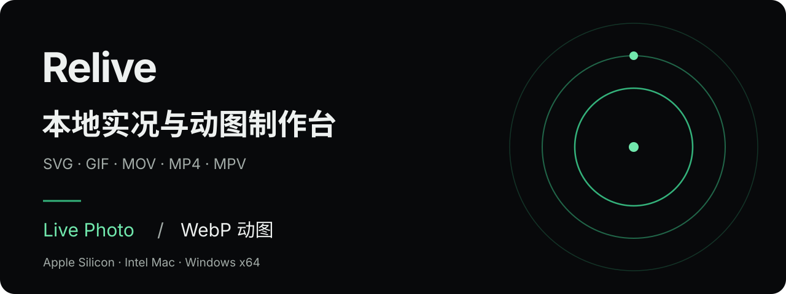
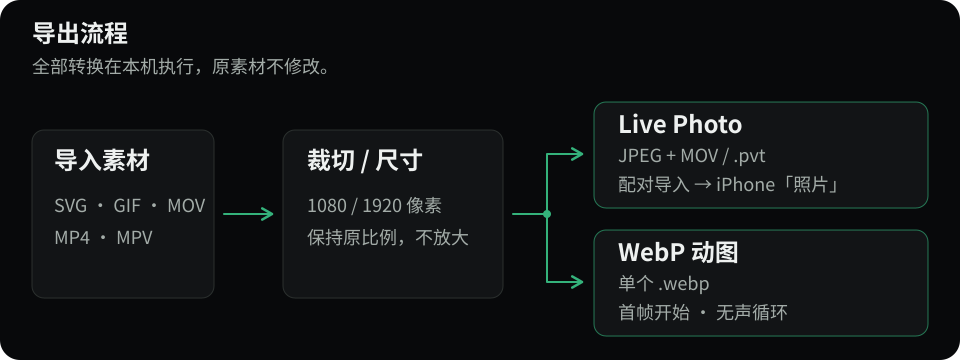

<div align="center">


# Relive 1.3.0

Relive 把图片、动画和视频制作成实况照片，也提供常用视频、动图和音频格式导出。通过本地操作台预览素材、逐帧选封面、裁切片段与画面，再保存到电脑；准备小红书实况图文时，可将 Live Photo 传到 iPhone 相册后确认效果。

作者用 Relive 制作了 [Magical Cards 的小红书实况示例](https://www.xiaohongshu.com/explore/6acf58e1000000001c00fbc5)。

<p>
  <a href="https://github.com/AbigBlackCat/Relive/releases/tag/v1.3.0"></a>
  
  
  <a href="LICENSE"></a>
</p>

<p>
  <a href="https://github.com/AbigBlackCat/Relive/releases/tag/v1.3.0">下载安装</a> ·
  <a href="#功能">功能</a> ·
  <a href="#制作与发布">制作与发布</a> ·
  <a href="#webp-动图">WebP 动图</a> ·
  <a href="#构建与验证">构建与验证</a> ·
  <a href="#实现与许可">实现与许可</a>
</p>



</div>

---

## 注意

已有 Windows 10 和 Apple Silicon macOS 13 的使用验证记录。发布实况图需要先将 Live Photo 导入 iPhone 系统相册，并确认 LIVE 标识及播放效果。WebP 是通用动图导出选项，不作为小红书发布方式推荐。

## 功能

本地实况与媒体制作台，支持 SVG、GIF、MOV、MP4、MPV 等素材，输出 Apple Live Photo、WebP、MP4、MOV、MKV、WebM、GIF、MP3 或 WAV。实况照片支持逐帧选择独立封面；音频格式用于提取有声音素材的音轨。界面参考 OpenScreen：素材栏、大预览、底部帧带与导出检查器。

## 安装

| 平台 | 系统要求 | 软件包 |
| --- | --- | --- |
| Apple Silicon Mac | macOS 13 或更新 | `Relive-1.3.0-AppleSilicon.dmg` |
| Intel Mac | macOS 13 或更新 | `Relive-1.3.0-Intel.dmg` |
| Windows x64 | Windows 10 / 11 | `Relive-1.3.0-Windows-x64-Setup.exe` 或 `Relive-1.3.0-Windows-x64.zip` |

Mac 打开对应芯片的 DMG，将 Relive 拖入「应用程序」。Windows 可以运行安装程序，或解压便携 ZIP 后打开 `Relive.exe`。三平台均内置 FFmpeg、ffprobe、WebP 工具及所需运行时；使用软件无需安装 Python、Node.js 或命令行工具。

macOS 包采用 ad-hoc 签名，未 Apple 公证；Windows 包未正式代码签名。

请下载 v1.3.0 安装包使用画面裁剪、新格式和画质档位；v1.2.0 仍可从历史发布页下载。

---

## 制作与发布

<p align="center">
  
</p>

打开 Relive → 导入素材 → 选择输出格式 → 调整片段 / 画面 / 画质 → 导出。默认保留完整片段，重名输出自动编号，原素材不修改。

四档画质为 **原画质、高清（最长边 1920）、标准（最长边 1080）、省空间（最长边 720）**。所有档位保持比例且不主动放大素材；后三档按最长边上限缩小；原画质通常保留原素材画布，设置画面裁剪后使用裁剪区域的尺寸。格式要求可能使宽高调整为相邻的偶数。原画质仍会重新编码，不保证逐位无损、原始编码、HDR 色彩或原始元数据完全保留；预览最长边最高 1920，不决定原画质导出的像素尺寸。

点击 **「裁剪画面」** 后，直接在预览中拖动边缘或四角调整范围，拖动选区移动位置，可重置为完整画面。画面裁剪作用于封面及所有视觉格式，并在画质缩放前执行；它与开始 / 结束时间的片段裁切分别控制画面范围和时间范围，音频导出不使用画面裁剪。

选择 **Live Photo** 时，可定位首帧、当前帧或输入任意封面帧号；帧号从 1 开始，封面须位于片段内。可以保留声音。

Live Photo 输出为 `.pvt` 包，内含配对 JPEG、MOV 与实况封面时间标记。Mac 原生版导出会通过 Apple Photos 框架识别校验；Windows 版执行配对结构、媒体与时间标记校验。其他格式不携带这套实况配对信息。

- **通过 Mac：** 双击 `.pvt` 或点击「导入照片」，导入 Mac「照片」。通过 iCloud 照片同步，或从「照片」内隔空投送到 iPhone。
- **仅用 Windows：** 将包内配对 JPEG 和 MOV 交由支持 Live Photo 配对导入的 iOS 相册工具，存入 iPhone 系统相册；也可以将 `.pvt` 转交 Mac「照片」后传到 iPhone。

在 iPhone「照片」确认 LIVE 标识并可播放后，再从小红书相册选择。单独导入 JPEG 或直接上传 `.pvt` 不会自动成为实况照片。iPhone 小红书实际发布尚未测试，识别结果以手机当前版本为准。

---

### 视频、GIF 与音频

**MP4、MOV、MKV** 提供常用视频封装；**WebM** 使用 VP9 视频及可选 Opus 音频。视觉导出沿用所选片段、画面裁剪及画质；有音轨的视频可按需保留声音。普通视频的首帧及播放顺序由导出片段决定，不使用 Live Photo 的独立封面时间标记。

**GIF** 按片段顺序循环播放，不含声音。其调色板最多 256 色，渐变和细节可能产生色带或抖动，文件也可能比视频大。GIF 与 WebP 的动画帧率最高 30 fps，透明区域沿用导入时选择的背景，不保证保留原透明通道。

**MP3、WAV** 用于导出所选片段的音轨，不使用封面或画面裁剪。没有音轨的素材无法导出音频。MP3 是有损压缩；WAV 输出 PCM 音频，体积通常较大。画质档位对音频使用对应的编码设置，不代表图片分辨率或原音频逐位复制。

### WebP 动图

选择 **WebP 动图** 后，封面与声音设置隐藏。输出一个 `.webp` 文件，按所选片段原顺序、从首帧开始无限循环，不含声音，最高 30 fps。界面显示实际尺寸、时长和文件大小，可通过片段、画面裁剪及画质控制体积。单帧及完全静止的素材可能被编码器合并为静态 WebP，软件会明确标注。

WebP 没有 Live Photo 的独立封面时间标记。导出不自动限制为 10 MB，也不截短素材。它作为通用动图文件使用；小红书实况发布请使用上面的 Live Photo 流程。WebP 转换使用 libwebp 1.6.0 的 `img2webp`，由 `webpinfo` 校验。

SVG 支持 SMIL / CSS 动画，导入前可设置录制 1–30 秒及白色 / 黑色背景。原画质模式下 SVG 录制的最长边上限为 4096；静态 SVG 不自动添加运动。外链和脚本不执行，DTD 与实体定义不接受；请使用 UTF-8，并内嵌图片 / 字体。素材预览规范化为 H.264，长边最高 1920 像素、帧率最高 60 fps；视频解码范围由内置 FFmpeg 决定。MPV 是 MPEG 视频文件。

全部转换在本机执行，不上传素材。编辑列表仅保留当前会话；关闭软件后清理临时预览，已导出的作品保留。

---

## 构建与验证

Mac 原生版需要 Xcode。FFmpeg 二进制不存入 Git：Apple Silicon 运行时由 `scripts/bundle_ffmpeg.py` 从 arm64 Conda 环境收集，默认读取 `/opt/anaconda3`，也可用 `--prefix` 指定包含 FFmpeg 的环境；Intel 准备脚本需要 Conda / Miniforge。

```sh
# Apple Silicon：先准备 Resources/bin 与 Resources/lib
python3 scripts/bundle_ffmpeg.py --arch arm64
python3 scripts/prepare_webp.py --target arm64
scripts/build.sh arm64
scripts/test.sh arm64
scripts/package.sh arm64

# Intel：准备对应 FFmpeg 后构建；自测需在 Intel Mac 上运行
python3 scripts/prepare_intel_ffmpeg.py
python3 scripts/prepare_webp.py --target x86_64
scripts/build.sh x86_64
scripts/test.sh x86_64
scripts/package.sh x86_64
```

Windows 版使用 Electron。开发与构建需要 Node.js 24、Python 3、CMake 和 Visual Studio 2022 或更新版本的 C++ 工具，脚本自动选择已安装且被 CMake 支持的版本；FFmpeg 准备脚本下载指定版本并校验 SHA256，WebP 工具从同一官方源码静态构建。

```sh
npm ci
npm run prepare:windows
python scripts/prepare_webp.py --target windows-x64
npm run desktop
npm run test:portable
npm run test:desktop
npm run build:windows
```

Windows 便携格式测试需要将 `RELIVE_FFMPEG` / `RELIVE_FFPROBE` 指向 `desktop/vendor/win32-x64/ffmpeg.exe` / `ffprobe.exe`。构建产物位于 `dist/windows/`。GitHub Actions 的 `Build Relive` 可手动选择 `all`、`windows` 或 `intel`，下载对应构建产物。

1.2.0 已有原生 Intel CI 自测、Windows 配对格式测试、完整转换 / SVG 捕获测试，以及打包后 Windows 可执行文件烟雾测试的通过记录。测试覆盖首 / 中 / 末帧封面、片段裁切、声音、重名保护、坏输入与取消；这些历史记录不代表新增格式、画质档位和画面裁剪已经完成跨平台验证，也不等同于 iPhone 小红书发布验证。

WebP 自测覆盖变化画面、静态合并、片段顺序、毫秒时长、帧率限制、重名输出与失败清理。三平台从校验过的官方 libwebp 1.6.0 源码静态构建工具，两个 Mac 架构的部署目标为 macOS 13；Windows 关闭上游 Unicode 参数开关，以支持相对路径参数文件。参数容量的小补丁与原始许可、来源校验值随包保存在 `licenses/webp/`。

---

## 实现与许可

Relive 自有源码采用 MIT License。第三方组件保留各自许可。

欢迎contributor加入二次开发，让Relive适用更多场景。

Mac 原生实现位于 `Sources/`；Windows 的 Electron 主进程、隔离桥、转换核心和操作台位于 `desktop/`。第三方声明、FFmpeg 许可证和精确构建来源随包保留在 `licenses/`。
